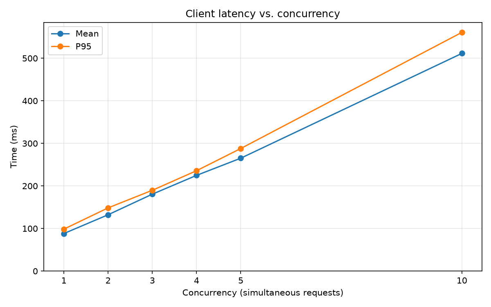
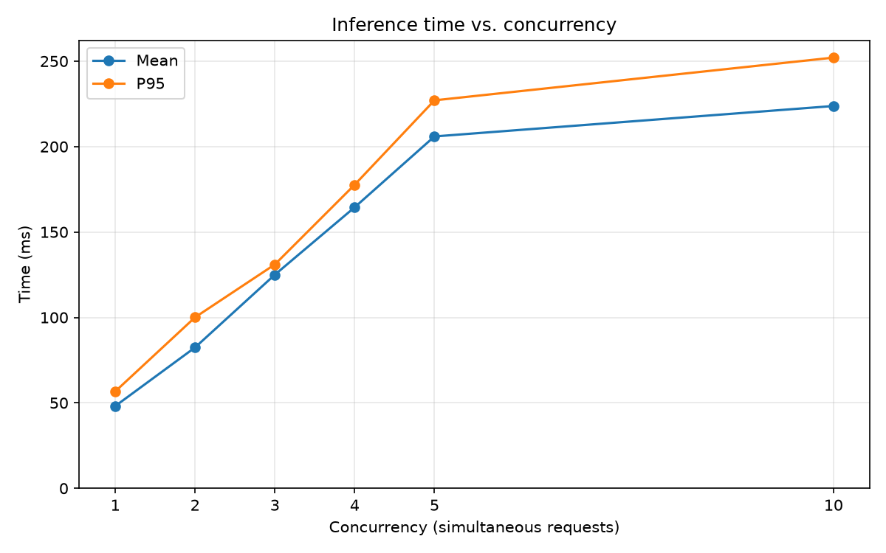
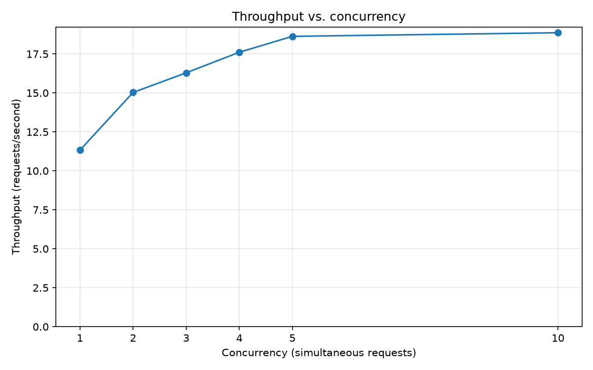

# Benchmark report

## Concurrency comparison

| Concurrency | File | Requests | Mean latency (ms) | P95 latency (ms) | Throughput (req/s) |
| ---: | --- | ---: | ---: | ---: | ---: |
| 1 | gpu_c1_run.txt | 100 | 88.16 | 98.51 | 11.33 |
| 2 | gpu_c2_run.txt | 100 | 132.3 | 148.47 | 15.03 |
| 3 | gpu_c3_run.txt | 100 | 180.66 | 189.81 | 16.29 |
| 4 | gpu_c4_run.txt | 100 | 224.83 | 235.79 | 17.61 |
| 5 | gpu_c5_run.txt | 100 | 265.18 | 287.96 | 18.63 |
| 10 | gpu_c10_run.txt | 100 | 511.33 | 560.76 | 18.86 |

## Graphs

### Client latency

### Inference time

### Throughput

## All metrics

| File | Concurrency | Metric | N | Mean (ms) | Median (ms) | P95 (ms) |
| --- | ---: | --- | ---: | ---: | ---: | ---: |
| gpu_c1_run.txt | 1 | client_latency | 100 | 88.16 | 89.05 | 98.51 |
| gpu_c1_run.txt | 1 | image_decode_time | 100 | 9.37 | 9.91 | 10.58 |
| gpu_c1_run.txt | 1 | inference_time | 100 | 48.12 | 48.53 | 56.69 |
| gpu_c1_run.txt | 1 | postprocessing_time | 100 | 0.3 | 0.31 | 0.4 |
| gpu_c1_run.txt | 1 | preprocessing_time | 100 | 19.89 | 21.32 | 21.97 |
| gpu_c1_run.txt | 1 | queue_time | 100 | 0.01 | 0.01 | 0.01 |
| gpu_c1_run.txt | 1 | upload_read_time | 100 | 0.04 | 0.05 | 0.06 |
| gpu_c2_run.txt | 2 | client_latency | 100 | 132.3 | 130.96 | 148.47 |
| gpu_c2_run.txt | 2 | image_decode_time | 100 | 10.75 | 10.73 | 11.35 |
| gpu_c2_run.txt | 2 | inference_time | 100 | 82.42 | 81.19 | 100.05 |
| gpu_c2_run.txt | 2 | postprocessing_time | 100 | 0.91 | 0.65 | 1.73 |
| gpu_c2_run.txt | 2 | preprocessing_time | 100 | 24.52 | 24.64 | 25.59 |
| gpu_c2_run.txt | 2 | queue_time | 100 | 0.01 | 0.01 | 0.01 |
| gpu_c2_run.txt | 2 | upload_read_time | 100 | 0.03 | 0.03 | 0.05 |
| gpu_c3_run.txt | 3 | client_latency | 100 | 180.66 | 180.91 | 189.81 |
| gpu_c3_run.txt | 3 | image_decode_time | 100 | 11.04 | 11.1 | 11.85 |
| gpu_c3_run.txt | 3 | inference_time | 100 | 125.0 | 125.37 | 131.01 |
| gpu_c3_run.txt | 3 | postprocessing_time | 100 | 2.02 | 1.98 | 3.25 |
| gpu_c3_run.txt | 3 | preprocessing_time | 100 | 25.2 | 25.11 | 27.55 |
| gpu_c3_run.txt | 3 | queue_time | 100 | 0.01 | 0.01 | 0.01 |
| gpu_c3_run.txt | 3 | upload_read_time | 100 | 0.03 | 0.03 | 0.05 |
| gpu_c4_run.txt | 4 | client_latency | 100 | 224.83 | 223.35 | 235.79 |
| gpu_c4_run.txt | 4 | image_decode_time | 100 | 10.52 | 10.85 | 11.93 |
| gpu_c4_run.txt | 4 | inference_time | 100 | 164.46 | 163.39 | 177.66 |
| gpu_c4_run.txt | 4 | postprocessing_time | 100 | 3.9 | 2.94 | 11.03 |
| gpu_c4_run.txt | 4 | preprocessing_time | 100 | 23.89 | 23.42 | 30.18 |
| gpu_c4_run.txt | 4 | queue_time | 100 | 0.01 | 0.01 | 0.01 |
| gpu_c4_run.txt | 4 | upload_read_time | 100 | 0.04 | 0.03 | 0.05 |
| gpu_c5_run.txt | 5 | client_latency | 100 | 265.18 | 263.56 | 287.96 |
| gpu_c5_run.txt | 5 | image_decode_time | 100 | 8.42 | 7.78 | 11.17 |
| gpu_c5_run.txt | 5 | inference_time | 100 | 205.93 | 208.09 | 227.06 |
| gpu_c5_run.txt | 5 | postprocessing_time | 100 | 4.72 | 3.11 | 14.71 |
| gpu_c5_run.txt | 5 | preprocessing_time | 100 | 27.32 | 24.54 | 50.88 |
| gpu_c5_run.txt | 5 | queue_time | 100 | 0.01 | 0.01 | 0.01 |
| gpu_c5_run.txt | 5 | upload_read_time | 100 | 0.03 | 0.03 | 0.06 |
| gpu_c10_run.txt | 10 | client_latency | 100 | 511.33 | 510.39 | 560.76 |
| gpu_c10_run.txt | 10 | image_decode_time | 100 | 11.64 | 11.58 | 14.03 |
| gpu_c10_run.txt | 10 | inference_time | 100 | 223.75 | 220.12 | 252.07 |
| gpu_c10_run.txt | 10 | postprocessing_time | 100 | 3.54 | 3.08 | 6.93 |
| gpu_c10_run.txt | 10 | preprocessing_time | 100 | 29.89 | 30.42 | 36.79 |
| gpu_c10_run.txt | 10 | queue_time | 100 | 213.85 | 217.05 | 266.13 |
| gpu_c10_run.txt | 10 | upload_read_time | 100 | 0.05 | 0.04 | 0.1 |

P95 is calculated using the nearest-rank method.
